# Changelog

All notable changes to this plugin are listed here. Versions follow
[Semantic Versioning](https://semver.org/); the version lives in
`addons/godot_nvim/plugin.cfg`.

Each version starts with a summary of at most three sentences, then has
Added, Removed and Fixed sections, with a screenshot for each major feature.
The release workflow turns a version's section into its GitHub release notes.

## [Unreleased]

### Added

- The Signals dock's **Go to Method** (right-click a connection) and
  double-clicking a connection open the connected method in Neovim, where
  they used to open Godot's script editor. The method is found in Neovim's
  buffer, so unsaved edits that moved it count.

  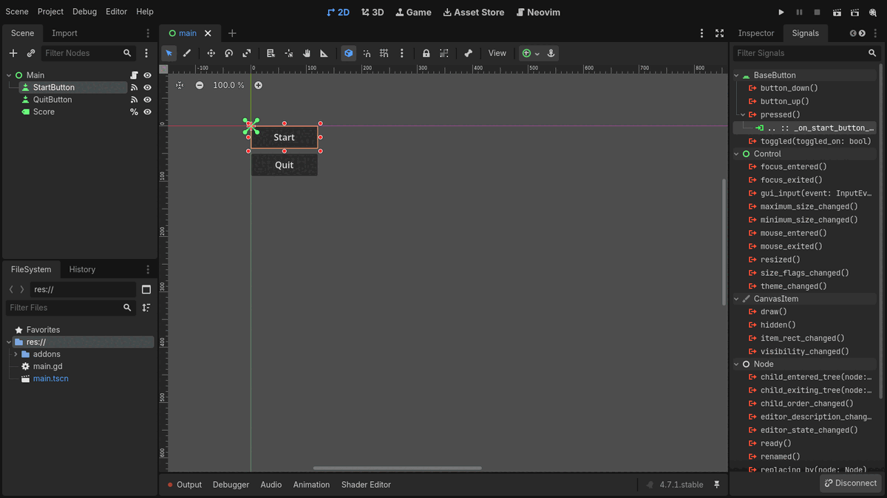

- A project website, [gdey.github.io/godotnvim](https://gdey.github.io/godotnvim/),
  with the features, install steps, the README as documentation and this
  changelog.

### Fixed

- The addon is no longer exported with your game. Its scripts were included
  in every export, though nothing loaded them; an export plugin now skips
  everything under `addons/godot_nvim/` while the plugin is enabled.
- `:bwipeout` or `:bdelete` on a buffer that was the only window of a scene's
  tab page closed the tab page and switched Godot to another scene. The tab
  page now stays and shows the next buffer, as Neovim does with a single tab
  page.

## [0.4.0] - 2026-10-26

Each scene open in Godot now gets its own Neovim tab page, and switching
scenes on either side switches the other. A new `start_clean` setting runs
Neovim without your config, to rule it out when something misbehaves.

### Added

- Editor Settings → `godot_nvim/start_clean` (off by default) starts Neovim
  with `--clean`, without your config, plugins and ShaDa, to rule them out
  when something misbehaves. The plugin's own features, including the
  session and format on save, keep working. Changing it restarts Neovim,
  or waits for `:qa` if there are unsaved changes.

  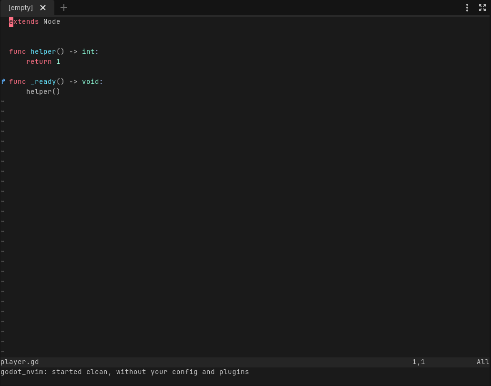

- Each scene open in Godot gets its own Neovim tab page. Switching scenes in
  Godot shows that scene's tab page, and switching tab pages in Neovim
  switches Godot's scene. Opening a scene makes its tab page; closing it
  closes the tab page and keeps its buffers. Scripts opened from Godot open
  in the current scene's tab page. The links are saved with the session.
  Editor Settings → `godot_nvim/link_scene_tabs` turns it off.

  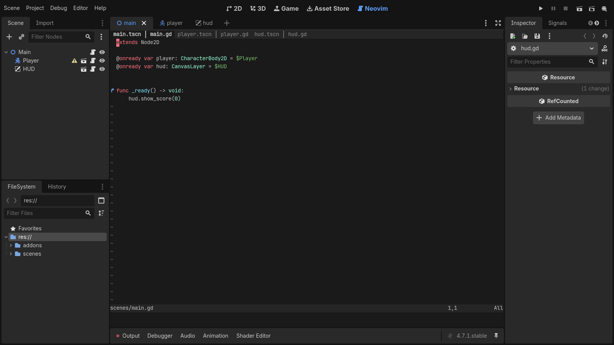

## [0.3.0] - 2026-10-25

Neovim now restores your open files, splits and tabs when the project
reopens, and Inspector properties can be dragged in as node paths.
`:GodotRunFile` runs an `EditorScript` from Neovim, and each release now
carries vim2godot, a tool that turns Vim colorschemes into Godot themes.

### Added

- `colorscheme/`: vim2godot, a Go tool that converts a Vim or Neovim
  colorscheme (any on vimcolorschemes.com) into a Godot editor theme, a `.tet`
  for the script editor plus an EditorScript for the interface colors. It is
  not part of the addon download. cendre is included as an example.

  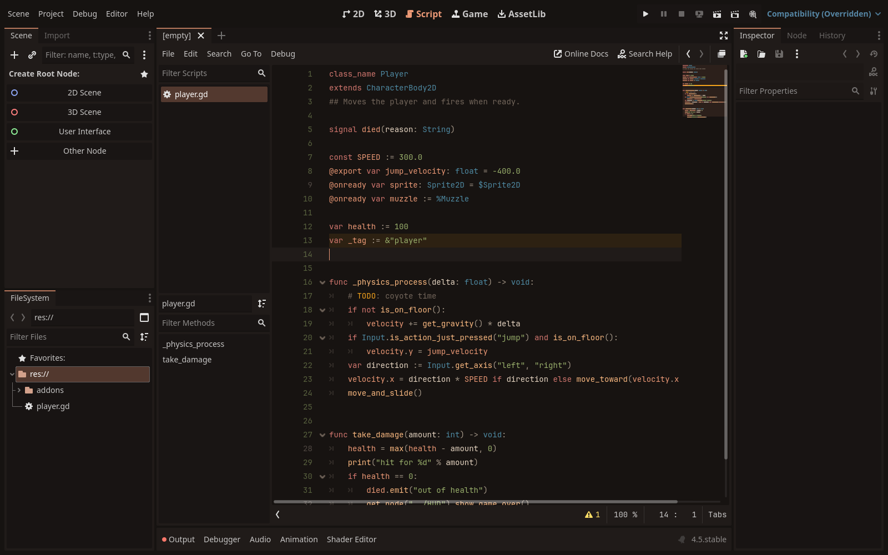

- Releases now also carry vim2godot prebuilt for Linux, macOS and Windows
  (amd64 and arm64) as `colorscheme-<version>-<os>-<arch>` archives, with the
  addon's version number, plus `SHA256SUMS.txt`. `vim2godot -version` prints
  the version.
- `:GodotRunFile [file]` runs a `@tool` script that extends `EditorScript`,
  as the script editor's File → Run does. Without a file it runs the current
  buffer, writing it first if it has unsaved changes. Files outside the
  project run after a confirmation.

  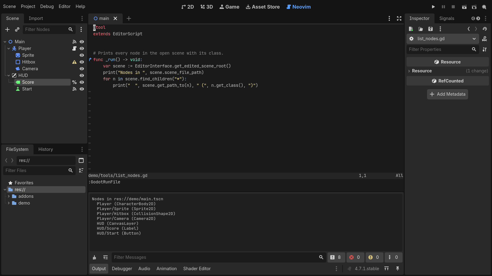

- Dragging a property from the Inspector into Neovim inserts it with its
  node path, `$Path/To/Node.property`, or with Ctrl/Cmd held, the NodePath
  string `"Path/To/Node:property"`.

  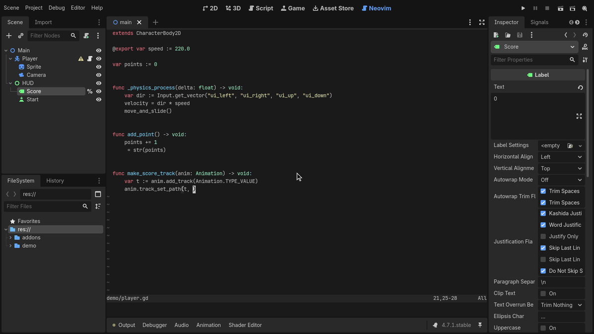

- Open files, cursor positions, splits and tabs are saved when the editor
  closes (or Neovim quits) and restored when the project opens again. The
  session lives in `.godot/godot_nvim/session.vim`. Editor Settings →
  `godot_nvim/restore_session` turns it off.

  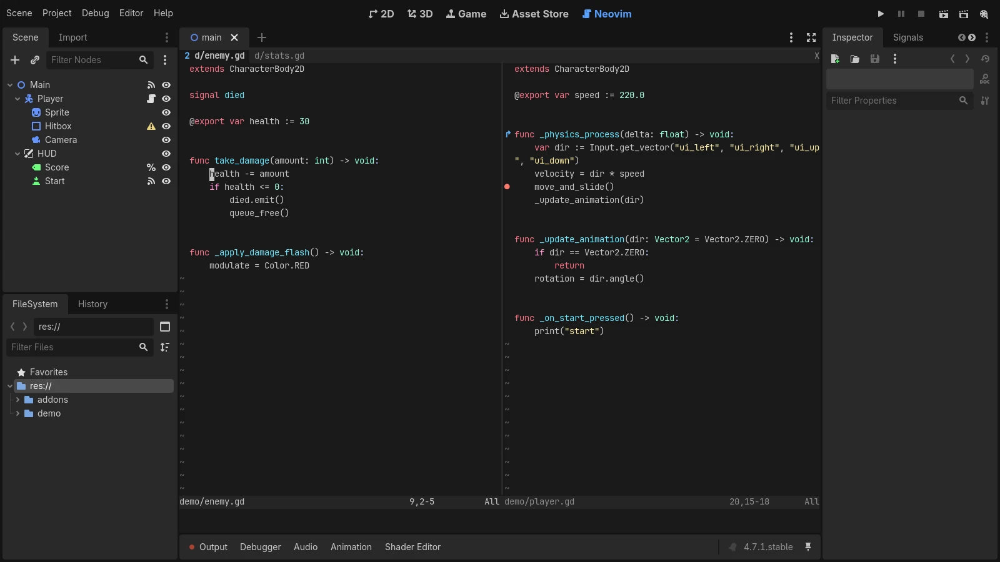

### Fixed

- A file opened from Godot while Neovim was still starting lost its line:
  Godot now holds files back until Neovim has started.
- The plugin failed to load on Godot 4.5, which lacks
  `EditorSettings.get_shortcut()`. There, the run shortcuts that work while
  typing are taken from the editor's run bar.

## [0.2.0] - 2026-10-25

GDScript files are now formatted on save, and `:GodotFunc` jumps to any
function in the project by name. A new Tools menu entry makes editor
profiles that hide Godot's Script tab, so Neovim is the only script editor.

### Added

- `:GodotFunc <name>` opens a GDScript function by name from anywhere in the
  project, with name completion. Several matches, or partial ones, go to the
  quickfix list. Godot's language server has no workspace symbol search.

  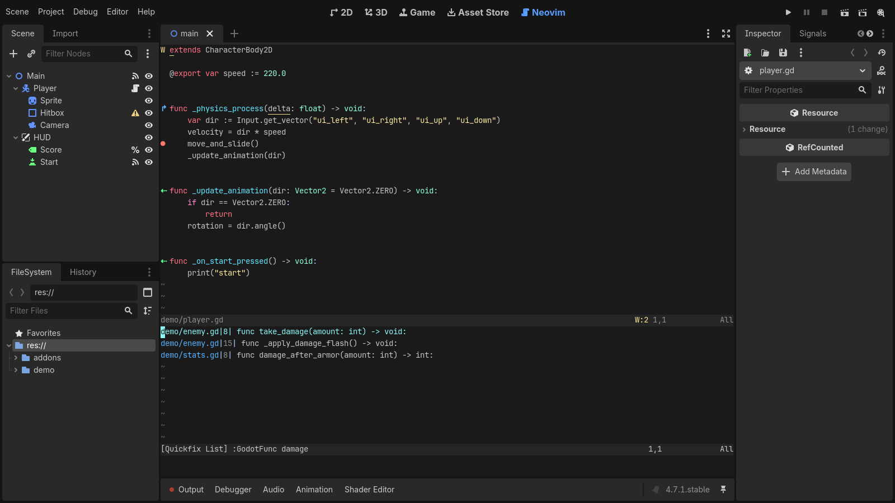

- Project → Tools → Create Neovim Editor Profiles: copies each editor feature
  profile to `<name>-neovim` with the Script screen hidden, and offers to
  switch to one. The README now recommends hiding the Script screen.

  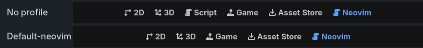

- GDScript formatting on save, on by default. It uses GDQuest's
  `gdscript-formatter` (including the copy its Godot add-on installs) or
  gdtoolkit's `gdformat`, whichever is found, and does nothing if neither is
  installed. Editor Settings → `godot_nvim/format_on_save` turns it off and
  `godot_nvim/formatter_command` picks another command. `:GodotFormat`
  formats on demand.

  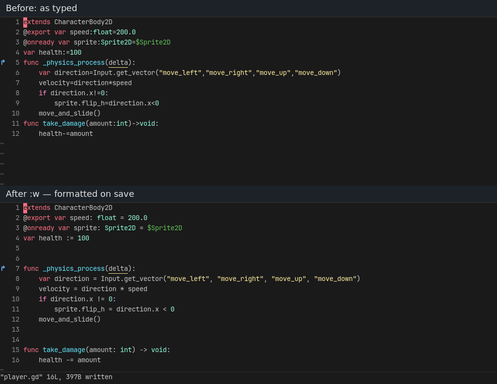

## [0.1.0] - 2026-10-25

The first release: Neovim embedded in the Godot editor as its script editor.
It keeps drag-and-drop, the GDScript language server, debugger breakpoints,
signal and override signs, the editor's colors and the run shortcuts.

### Added

- Neovim embedded in a main-screen tab through the UI protocol (ext_linegrid).
  GDScript, shaders and other text files open there instead of Godot's script
  editor.

  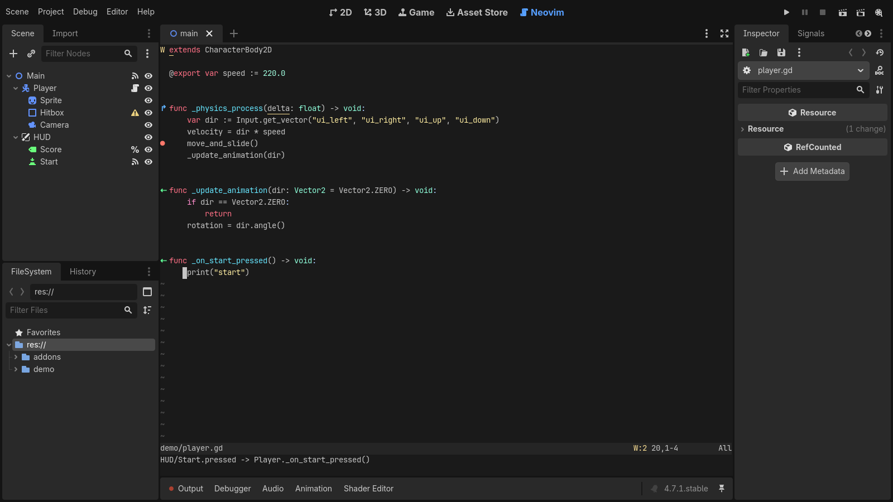

- Drag-and-drop of scene nodes and files from the Scene and FileSystem docks.
  The inserted text matches Godot's script editor (`$Node`, `$"../Path"`,
  `%Unique`, `preload(...)`, `@onready var` with Ctrl/Cmd).

  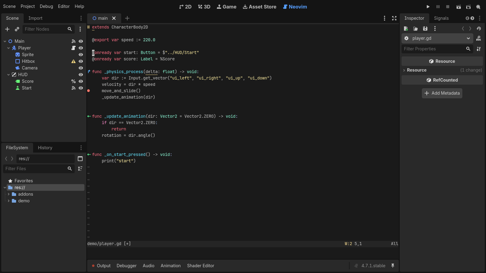

- The GDScript language server, connected automatically.

  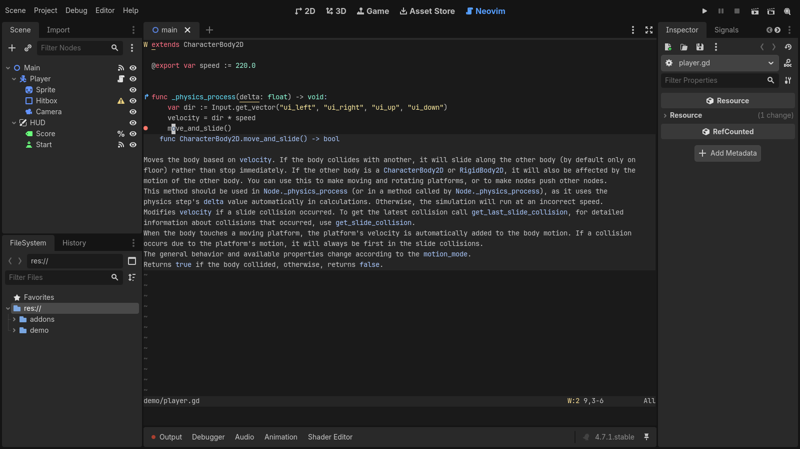

- Debugger breakpoints as signs. Toggle them with F9 or a double-click on the
  gutter. They sync both ways with Godot's debugger, follow its go-to-line,
  and grey out while Skip Breakpoints is on.
- Signs for methods connected to signals (`⇠`) and for overridden virtual or
  inherited methods (`↱`). `:GodotConnections` lists both for the method
  under the cursor.
- A `godot` colorscheme built from the editor's text editor colors, updated
  when the editor theme changes (setting `godot_nvim/use_editor_colors`).
- The editor's run shortcuts work inside Neovim (Run Project, Run Current
  Scene, Run Specific Scene, Pause, Stop), plus `:GodotRun`,
  `:GodotRunCurrent`, `:GodotRunScene`, `:GodotPause` and `:GodotStop`.
- `:w` saves without moving focus out of Neovim. `:q` closes the buffer
  instead of Neovim, and `:wq` saves then closes it.
- Asset Library packaging, and a release workflow that publishes the addon
  zip when a version tag is pushed.

[0.4.0]: https://github.com/gdey/godotnvim/releases/tag/v0.4.0
[0.3.0]: https://github.com/gdey/godotnvim/releases/tag/v0.3.0
[0.2.0]: https://github.com/gdey/godotnvim/releases/tag/v0.2.0
[0.1.0]: https://github.com/gdey/godotnvim/releases/tag/v0.1.0
