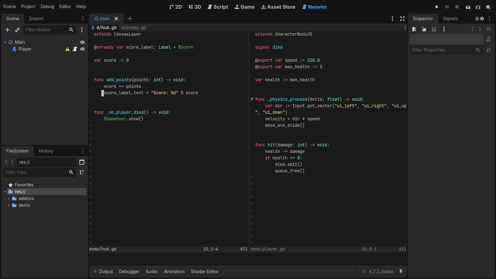
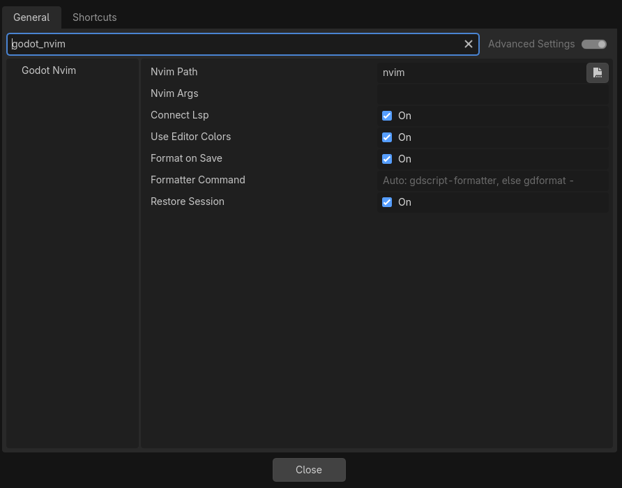
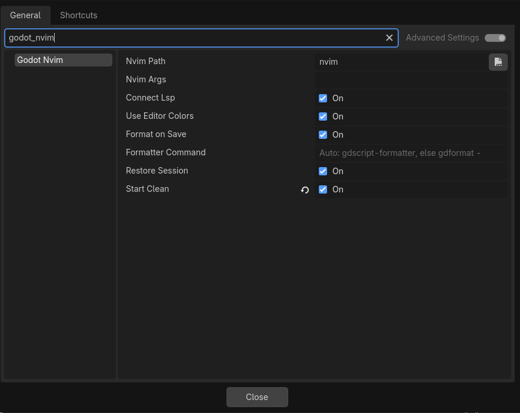
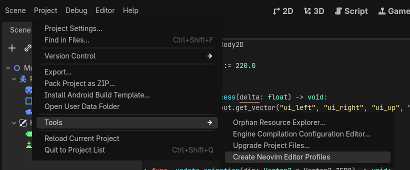
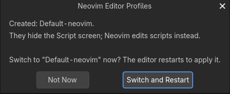
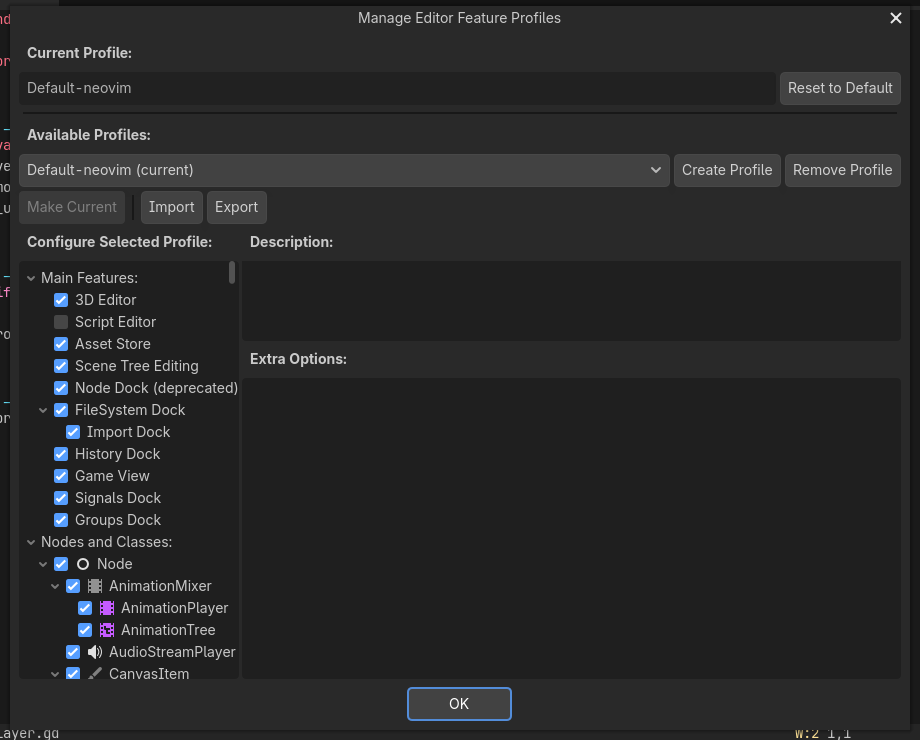
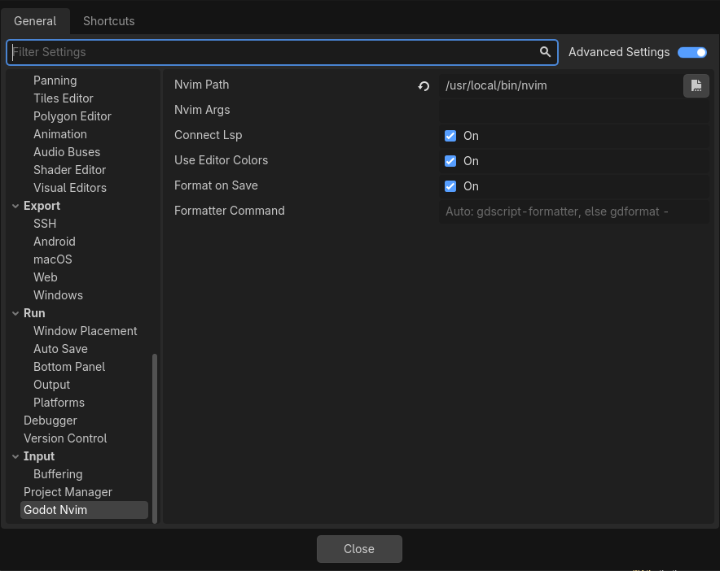

# godotnvim

A Godot 4 editor plugin that edits GDScript, shaders and other text files in
an embedded Neovim, drawn inside the editor with Neovim's UI protocol
(`ext_linegrid`). It keeps the parts of Godot's script editor that matter:

- dragging nodes or files from the editor's docks inserts the same text Godot
  does, and dragging an Inspector property inserts its node path;
- the GDScript language server gives hover docs, definitions and completion;
- debugger breakpoints show in the gutter, in sync with Godot's debugger;
- signs mark methods that signals connect to and methods that override a base
  class, and the Signals dock's Go to Method opens the method in Neovim;
- Neovim takes its colors from the script editor's theme;
- Godot's run, pause and stop shortcuts keep working while you type.

Your Neovim config, plugins and keymaps load as usual.


## Requirements

- **Godot 4.5 or newer.** The tests pass on 4.5.1, 4.6.1 and 4.7.1. On 4.4
  the editor can be killed by `SIGPIPE` when Neovim stops, and 4.3 lacks
  APIs the plugin uses.
- **Neovim 0.9 or newer**, installed separately. 0.11+ is recommended for its
  default LSP mappings.
- **Platforms:** Linux is tested. macOS is in daily use. Windows should work
  but is untested; reports welcome.

## Install

From the Asset Library: search for "Neovim Script Editor", install, then
enable it as below.

Copy `addons/godot_nvim` into your project's `addons/` folder, then enable
**Neovim Script Editor** under Project → Project Settings → Plugins. A
**Neovim** tab appears next to 2D / 3D / Script.

The plugin looks for `nvim` in `/opt/homebrew/bin`, `/usr/local/bin` and
`/usr/bin` (apps started from the macOS Dock don't see your shell's `PATH`).
To use a different binary, set it in Editor Settings → `godot_nvim/nvim_path`.
You can pass extra arguments, such as `-u NONE`, in `godot_nvim/nvim_args`.
Neovim starts in the project folder and loads your usual config.

The plugin only runs in the editor, so it leaves itself out of exported games:
nothing under `addons/godot_nvim/` is exported, and you don't need an export
filter for it.

## Use

- Open any text file from the FileSystem dock: scripts, shaders
  (`.gdshader`, `.gdshaderinc`), `.json`, and plain text (`.cfg`, `.txt`,
  `.md`, …). It opens in the Neovim tab. Scenes and `.tres` resources still
  open in their usual editors.
- Drag a node from the Scene dock onto the view to insert `$Path/To/Node`
  (or `%Name` for unique names). Hold Ctrl (Cmd on macOS) while dropping to
  insert `@onready var node_name: Type = $Path/To/Node` above the line under
  the mouse. Type hints follow Editor Settings →
  `text_editor/completion/add_type_hints`.
- Drag files from the FileSystem dock to insert `"res://path"`, or with
  Ctrl/Cmd held, `const Name = preload("res://path")`.

  

- Drag a property from the Inspector to insert it with its node path:
  `$Path/To/Node.property` (just `property` for the script's own node, and
  `.get("group/property")` for properties with a slash). Hold Ctrl (Cmd on
  macOS) to insert the NodePath string `"Path/To/Node:property"` instead,
  as animation tracks take. Properties of a resource rather than a node
  insert the quoted name, as Godot does.

  

- `:w` saves, and Godot reloads the script, shader or JSON.
- Like Godot's own script editor, unsaved Neovim buffers are written when you
  save a scene or run the project, and Godot asks about them when it closes.
- Neovim runs for as long as the editor does. On the last window, `:q` acts
  like `:bd` and `:wq` / `:x` like `:w` + `:bd`: the file closes, the previous
  file (or an empty placeholder) shows, and Neovim keeps running. If Neovim exits anyway
  (`:qa`, a crash), it restarts on the last file.

## Reopening files

When the editor closes, Neovim saves which files are open, where the cursor
is in each, and the splits and tabs. The next time you open the project they
come back as you left them. A file you open from Godot at startup, such as by
double-clicking a script, lands on top of the restored layout.



The session is per project, in `.godot/godot_nvim/session.vim` (Godot keeps
`.godot/` out of version control). It's written with `:mksession`, without
options, mappings or the working directory, which stay with your config.
Windows on scratch buffers, such as file trees, aren't saved, and files
deleted in the meantime don't come back. Leaving Neovim with `:qa` saves the
session too, so the restart that follows restores it.

To turn this off, for example because a session plugin of your own does the
same, clear Editor Settings → `godot_nvim/restore_session` (Advanced Settings
must be on to see it).



## Starting clean

To check whether something odd comes from your Neovim config or a plugin of
yours, turn on Editor Settings → `godot_nvim/start_clean` (Advanced Settings
must be on to see it). Neovim restarts with `--clean`: no `init.lua`, no
plugins and no ShaDa (marks, registers and history aren't read or written),
and says "started clean" at the bottom. If there are unsaved changes it
waits until you `:qa`, so nothing is lost.




Everything this plugin does itself keeps working, because its Lua is sent
to Neovim over RPC rather than loaded from your config: drag and drop,
breakpoints, the GDScript language server, the `godot` colorscheme, format
on save and the session. The session is shared with normal starts, so the
files you had open come back either way, and turning the setting off again
returns to where you were. Arguments in `godot_nvim/nvim_args` are still
passed after `--clean`.

## Scene tabs

Each scene open in Godot's scene tabs gets its own Neovim tab page. Switching
scenes in Godot shows that scene's tab page, and switching tab pages in
Neovim (`gt`, `:tabnext`, a click on the tabline) switches Godot's scene. A
script opened from the Scene dock or the Inspector opens in the current
scene's tab page, even when another scene's tab already shows it, since
jumping there would switch scenes.


- Opening a scene makes its tab page, in the same order as Godot's tabs. The
  first scene takes the tab page Neovim already has.
- Closing a scene closes its tab page. Its buffers stay open, and ones with
  unsaved changes are kept hidden; `:ls` lists them.
- `:bd` or `:bw` in a scene's tab page shows the next buffer there, as with a
  single tab page, rather than closing the tab page.
- A scene saved under a new name (Save Scene As, or a new scene's first save)
  keeps its tab page.
- Tab pages you make yourself aren't tied to a scene and are left alone.
  Closing a scene's tab page in Neovim doesn't close the scene; switching to
  the scene again makes a new one.
- Which tab page belongs to which scene is saved with the session, in
  `.godot/godot_nvim/session.scenes.json`.
- If your config doesn't set `'tabline'`, tab labels show the scene and the
  file, such as `player.tscn │ player.gd`. A custom tabline can read the
  scene's path from `t:godot_scene`.

To turn this off, clear Editor Settings → `godot_nvim/link_scene_tabs`.

## Hiding the Script screen

Godot still opens its own script editor alongside Neovim, so the Script tab
is best hidden with an editor feature profile. The plugin keeps working with
it hidden: files open in Neovim, and breakpoints still sync.


**Project → Tools → Create Neovim Editor Profiles** does this for you:



For every profile you have (Editor → Manage Editor Features), it saves a copy
named `<name>-neovim` with the Script screen turned off. If you have no
profiles, it makes `Default-neovim`. Profiles that already end in `-neovim`
are skipped, and existing `-neovim` copies aren't overwritten, so delete one
to regenerate it. It then offers to switch to the `-neovim` copy of your
current profile, which restarts the editor:



To switch profiles later, or to do it by hand, open Editor → Manage Editor
Features. Pick a profile and press **Make Current** (or **Reset to Default**
for no profile). The **Script Editor** box under Main Features is what shows
or hides the Script tab.



## Running the project

Godot's run shortcuts work while typing in Neovim: Run Project, Run Current
Scene, Run Specific Scene, Pause and Stop (F5, F6, Ctrl+Shift+F5, F7, F8; on
macOS Cmd+B, Cmd+R, Cmd+Shift+R, Ctrl+Cmd+Y, Cmd+.). They follow your
bindings in Editor Settings → Shortcuts. The same actions are commands:

| Command | Does |
| --- | --- |
| `:GodotRun` | Run the project's main scene |
| `:GodotRunCurrent` | Run the scene open in the editor |
| `:GodotRunScene [file]` | Run a `.tscn`/`.scn` (completes file names); without a file, pick one as Godot does |
| `:GodotPause` | Pause or resume the running project |
| `:GodotStop` | Stop the running project |
| `:GodotRunFile [file]` | Run an `EditorScript`, as the script editor's File → Run does; without a file, the current buffer |

`:GodotRunFile` runs scripts that start with `@tool` and extend
`EditorScript`, calling their `_run()` in the editor, for one-off editor
tasks:

```gdscript
@tool
extends EditorScript

func _run() -> void:
	print(EditorInterface.get_edited_scene_root())
```

Godot runs the file as saved, so the command writes its buffer first when it
has unsaved changes. Files outside the project run too, as they do from
Godot's script editor, after Neovim asks you to confirm. A script that has errors, is not a tool script, or does
not extend `EditorScript` is not run, and the reason shows in Neovim and in
Godot's Output panel. `print()` output goes to the Output panel.


## Debugger

- Breakpoints show as `●` signs in Neovim's sign column (highlight group
  `GodotBreakpoint`: the editor's breakpoint color, or `DiagnosticError` with
  your own colorscheme). They stay in sync with
  Godot's Breakpoints list, whether you set them from Neovim, Godot's own
  editor gutter, or the debugger panel. While the debugger's **Skip
  Breakpoints** is on, the signs turn grey (`GodotBreakpointSkipped`, linked
  to `Comment`).
- `F9` (Godot's key) or `:GodotToggleBreakpoint` toggles a breakpoint on the
  cursor line, and double-clicking the gutter (sign or number column) toggles
  one on the clicked line. If you already map `F9` or `<2-LeftMouse>`, the
  plugin leaves your mapping alone. So there's always a gutter to click,
  GDScript buffers get `signcolumn=yes` when yours is the default `auto`.
- Signs move with your edits. On `:w`, Godot's breakpoints move to match.
- Double-clicking a breakpoint, an error or a stack frame in the debugger
  opens the file in Neovim at that line.

## Signal connections and overrides

Like Godot's script editor, the sign column marks methods:

- `⇠` on a method that a signal in the edited scene is connected to
  (highlight `GodotSignalSlot`, green).
- `↱` on a method that overrides one from a base class, such as `_ready()` or
  a method of a base script (highlight `GodotMethodOverride`, blue).
- `↱⇠` when both apply.

The colors are the ones Godot's own icons use. To restyle them, define the
highlight groups in your config, for example
`vim.api.nvim_set_hl(0, "GodotMethodOverride", { fg = "#ffcc00", bold = true })`.

Change the glyphs with `vim.g.godot_nvim_slot_sign`,
`vim.g.godot_nvim_override_sign` and `vim.g.godot_nvim_override_slot_sign`.
`:GodotConnections` shows the signals connected to the function under the
cursor and the method it overrides. A connection to a method the script
doesn't have shows up as a warning diagnostic. Signal signs follow the scene
you're editing and update when you connect or disconnect signals in the Node
dock; override signs update as you type, and follow `extends` when you save.

In the Node dock's Signals tab, **Go to Method** (right-click a connection)
and double-clicking a connection open the connected method in Neovim, as
they do in Godot's script editor. The method is found in Neovim's buffer, so
unsaved edits that moved it count. If the buffer has no such `func`, the file
opens with a warning.


## Colors

Neovim uses the script editor's colors: the plugin builds a `godot`
colorscheme from Editor Settings → `text_editor/theme/highlighting` (syntax,
treesitter and LSP groups, plus the cursor line, selection, line numbers,
popup menu and status line). It replaces the colorscheme from your config, and
follows the editor when you change its colors or pick another text editor
theme. Translucent Godot colors are blended over the background, since Neovim
colors can't be translucent.

To keep your own colorscheme, clear Editor Settings →
`godot_nvim/use_editor_colors` (it takes effect when Neovim restarts, for
example after restarting the editor). `:colorscheme godot` switches back to the
editor's colors at any time.

To go the other way and give Godot the colors of a Vim colorscheme, use
[`colorscheme/`](colorscheme/README.md): a Go tool that converts any scheme
from [vimcolorschemes.com](https://vimcolorschemes.com/) into a Godot editor
theme (script-editor colors and interface colors). Neovim then follows that
theme through the `godot` colorscheme. Each release has prebuilt binaries of
it for Linux, macOS and Windows.


## Language server

The plugin connects `.gd` buffers to the GDScript language server that the
Godot editor runs (host and port come from Editor Settings →
`network/language_server/remote_host` / `remote_port`, default
`127.0.0.1:6005`). This gives hover docs (including the engine class
reference), go-to-definition, references, rename and completion.

If your own config already sets up a `gdscript` client (`vim.lsp.enable("gdscript")`
or nvim-lspconfig), the plugin leaves it alone and uses yours. To turn the
plugin's client off entirely, clear Editor Settings → `godot_nvim/connect_lsp`.

On Neovim 0.11+ the default LSP mappings cover most of it: `K` for hover,
`Ctrl-]` for definition, `grr` for references, `grn` for rename, `gra` for
code actions, and `Ctrl-x Ctrl-o` for completion. For completion as you type
and a `gd` mapping, add something like this to your config:

```lua
vim.api.nvim_create_autocmd("LspAttach", {
  callback = function(ev)
    local client = vim.lsp.get_client_by_id(ev.data.client_id)
    if client and client.name == "gdscript" then
      vim.lsp.completion.enable(true, client.id, ev.buf, { autotrigger = true })
      vim.keymap.set("n", "gd", vim.lsp.buf.definition, { buffer = ev.buf })
    end
  end,
})
```

Godot's language server can't search symbols across the project
(`workspace/symbol`), so the plugin adds `:GodotFunc <name>`. It opens the
function with that name in any `.gd` file under the project, with name
completion on Tab. When several functions share the name, or none matches
exactly but some contain it, they go to the quickfix list instead.


### Errors across the project

Godot's language server only reports errors for files you have open, so
`:GodotErrors` checks every `.gd` file in the project with it. If there are
errors, they go to the quickfix list and it opens; if there are none, it says
so and closes a list it opened before. `:GodotErrors!` lists warnings too.
Files you have open in Neovim are checked as they are in the buffer, unsaved
edits included; the rest are read from disk. It needs the language server, so
Godot's editor has to be running with `godot_nvim/connect_lsp` on (or your own
`gdscript` client).

<!-- screenshot: docs/screenshots/project-errors.png -->

## Formatting

GDScript files are formatted when you save them (`:w`, or when Godot saves
Neovim's buffers). Godot has no GDScript formatter of its own, so install one:

- **[GDQuest's GDScript Formatter](https://github.com/GDQuest/GDScript-formatter)**
  (`gdscript-formatter`), a single binary. If you use its Godot add-on, the
  copy the add-on installed is picked up, along with its indent settings.
- **[gdtoolkit](https://github.com/Scony/godot-gdscript-toolkit)**'s
  `gdformat`: `pip install "gdtoolkit==4.*"`.

The plugin looks for `gdscript-formatter` first, then `gdformat`, in your
`PATH`, `/opt/homebrew/bin`, `/usr/local/bin`, `~/.local/bin` and
`~/.cargo/bin`. With neither installed, files save as they are. To use
another command, set Editor Settings → `godot_nvim/formatter_command`; it
must read the code on stdin and print the formatted code, like
`gdformat -`. Both tools read `.editorconfig` / `gdformatrc` from the
project folder.

Turn formatting on save off with Editor Settings →
`godot_nvim/format_on_save` (Advanced Settings must be on to see it).
`:GodotFormat` formats the current buffer either way. To skip one buffer, set
`vim.b.godot_nvim_format = false` in it.



Only the lines the formatter changed are replaced, so breakpoints, marks and
the cursor stay put, and one `u` undoes your last change together with the
formatting. If the formatter fails (for example on a syntax error) the file
saves unformatted and a warning shows in Neovim.


## Settings

Editor Settings → `godot_nvim/`:

| Setting | Default | What it does |
| --- | --- | --- |
| `nvim_path` | found automatically | The `nvim` binary |
| `nvim_args` | empty | Extra arguments for Neovim, such as `-u NONE` |
| `connect_lsp` | on | Attach Godot's GDScript language server to `.gd` buffers |
| `use_editor_colors` | on | Use the `godot` colorscheme built from the script editor's colors |
| `format_on_save` | on | Format `.gd` files when saving, if a formatter is installed |
| `formatter_command` | empty: `gdscript-formatter`, else `gdformat -` | The formatter command; reads stdin, prints the result |
| `restore_session` | on | Save the open files, cursors, splits and tabs on close and restore them on open |
| `start_clean` | off | Start Neovim with `--clean`, without your config and plugins |
| `link_scene_tabs` | on | Give each open scene its own Neovim tab page, and switch them together |

Neovim commands: `:GodotRun`, `:GodotRunCurrent`, `:GodotRunScene`,
`:GodotRunFile`, `:GodotPause`, `:GodotStop`, `:GodotToggleBreakpoint`, `:GodotConnections`,
`:GodotFunc`, `:GodotErrors`, `:GodotFormat`, and `:colorscheme godot`.

## Known gaps

- Godot's breakpoint API lives in its own script editor, so the plugin keeps
  scripts with breakpoints open there in the background.
- Godot's own editors still load the file in the background: plain text files
  get a tab in the script editor, and shaders may open the shader editor
  panel. The engine does this before any plugin sees the file. Edit in Neovim
  only, or the copies can drift apart.
- Some features go through Godot's editor internals because no plugin API
  exists yet. [docs/godot-api-wishlist.md](docs/godot-api-wishlist.md) lists
  each one and the Godot API that would replace it.
- Only one grid (no `ext_multigrid`). The popup menu, cmdline and messages
  are drawn by Neovim inside the grid.

## Layout

| File | What it does |
| --- | --- |
| `msgpack.gd` | MessagePack encoder and streaming decoder |
| `nvim_rpc.gd` | Starts `nvim --embed` through `OS.execute_with_pipe`, msgpack-RPC requests and notifications |
| `nvim_grid.gd` | `ext_linegrid` screen state (cells, highlights, cursor, mode) |
| `nvim_view.gd` | Control that draws the grid and sends keyboard, mouse and drops to Neovim |
| `nvim_keys.gd` | Turns Godot key events into Neovim key notation |
| `drop_text.gd` | Builds the text for dropped nodes, files and Inspector properties |
| `godot_nvim.lua` | Neovim side: save and buffer notifications, `:q` handling, sessions, drop insertion, breakpoint, signal and override signs, LSP setup, run commands |
| `theme_colors.gd` | Reads the script editor's colors for Neovim's `godot` colorscheme |
| `nvim/colors/godot.lua` | The `godot` colorscheme (needs the colors from the editor) |
| `debugger_bridge.gd` | EditorDebuggerPlugin: forwards the debugger's go-to-line and breakpoint events |
| `editor_profiles.gd` | Makes the `-neovim` editor feature profiles |
| `export_excluder.gd` | EditorExportPlugin: keeps the addon out of exported games |
| `plugin.gd` | EditorPlugin: the main-screen tab, opening files, editor settings, breakpoint/connection/override/color sync, run actions |

## Tests

```sh
NVIM=/path/to/nvim godot --headless --path . -s tests/run_tests.gd
```

Add `--editor` to also test running an `EditorScript`, which only the editor
can do. The first run in a fresh checkout needs `godot --headless --path . --editor --quit`
first, so Godot registers the addon's `class_name`s.

## Releasing

Bump `version` in `addons/godot_nvim/plugin.cfg` and add a section for it to
`CHANGELOG.md`: a summary of at most three sentences, then Added, Removed and
Fixed sections, with a screenshot for each major feature. Commit, then push a
matching tag:

```sh
git tag v0.4.0 && git push origin v0.4.0
```

The Release workflow checks the tag against `plugin.cfg`, runs the addon's and
the colorscheme tool's tests, and publishes one GitHub release. Its notes,
built by `.github/release-notes.sh`, are the version's summary, an About
section from `docs/release/about.md`, and the version's Added, Removed and
Fixed sections, with screenshots pinned to the tag. To rewrite an existing
release's notes after editing them, run the Release notes workflow from the
Actions tab with the tag. Its assets, all with the
same version:

- `godot_nvim-<version>.zip`: the `addons/godot_nvim` folder
- `colorscheme-<version>-<os>-<arch>.tar.gz` (`.zip` for Windows): the
  [`vim2godot`](colorscheme/README.md) colorscheme tool, for Linux, macOS and
  Windows on amd64 and arm64
- `SHA256SUMS.txt`: checksums of the files above
