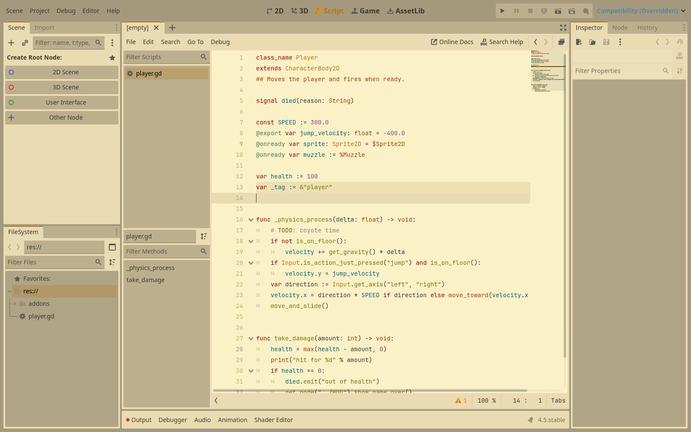
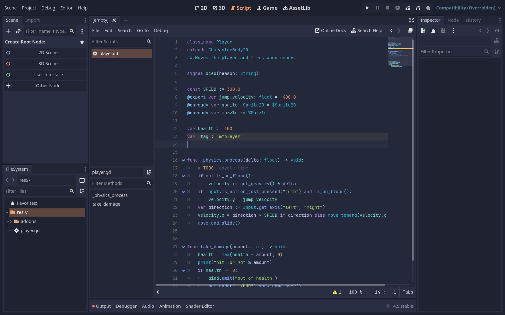

# vim2godot

Turns a Vim or Neovim colorscheme, such as any on
[vimcolorschemes.com](https://vimcolorschemes.com/), into a Godot 4.5+ editor
theme. It is separate from the godotnvim plugin and does not need it.


| gruvbox (light) | tokyonight-storm |
| --- | --- |
|  |  |

## How Godot editor themes work

Godot themes the editor in two separate layers, both per user rather than per
project:

- **Script editor colors**: Editor Settings → Text Editor → Theme →
  Color Theme picks a `.tet` file from Godot's `text_editor_themes` folder.
  A `.tet` is a ConfigFile with a `[color_theme]` section of
  `key="rrggbbaa"` lines, one per `text_editor/theme/highlighting/*` setting.
- **Everything else** (docks, panels, inspector): Editor Settings →
  Interface → Theme. With the preset set to Custom, Godot derives the whole
  interface from a base color and an accent color, with Contrast setting how far
  panels step away from the base.

vim2godot writes both: a `.tet`, and an EditorScript that sets the interface
colors and selects the `.tet`.

## Requirements

- [Neovim](https://neovim.io/) 0.10+ (`nvim` on your `PATH`, or `-nvim`/`$NVIM`)
- git, to fetch schemes that aren't already on disk
- Go 1.24+, only to run or build it from source

## Get it

Each [release](https://github.com/gdey/godotnvim/releases) has a prebuilt
`vim2godot` for Linux, macOS and Windows (amd64 and arm64), as
`colorscheme-<version>-<os>-<arch>.tar.gz` (`.zip` on Windows), with the same
version number as the addon. Unpack it and put `vim2godot` on your `PATH`.
`SHA256SUMS.txt` in the release has the checksums. On macOS, the binary isn't
signed: if Gatekeeper blocks it, run `xattr -d com.apple.quarantine vim2godot`.

Or run it from source in this directory: use `go run .` wherever the examples
below say `vim2godot`.

## Convert a scheme

```sh
vim2godot https://vimcolorschemes.com/r/aejkatappaja/cendre
```

The argument can be a vimcolorschemes.com page, a GitHub URL, `owner/name`
(GitHub), any other git URL, or a local directory. Each scheme in the repo's
`colors/` folder becomes `themes/<name>/` with:

- `<name>.tet`: the script-editor colors
- `apply_<name>.gd`: sets the interface colors and switches to the theme

A scheme that has both dark and light versions (it follows `'background'`) is
written twice, as `<name>-dark` and `<name>-light`. Useful flags:

| Flag | Does |
| --- | --- |
| `-out dir` | Where to write themes (default `themes`) |
| `-scheme a,b` | Only these colorschemes from the repo (default: all in `colors/`) |
| `-background dark` | Only try this `'background'` (default `dark,light`) |
| `-with owner/repo` | Repos the scheme needs on `'runtimepath'`, such as `rktjmp/lush.nvim` for zenbones |
| `-install` | Also copy the `.tet` files into Godot's `text_editor_themes` folder |
| `-nvim path` | Neovim to use (or set `$NVIM`) |
| `-version` | Print the version |

For example, only tokyonight's storm style, installed straight into Godot:

```sh
vim2godot -scheme tokyonight-storm -install folke/tokyonight.nvim
```

**This runs the colorscheme's code** in Neovim (`nvim --headless --clean`), so
only convert schemes you would load in your own editor.

## Install a theme in Godot

1. Copy `<name>.tet` into Godot's `text_editor_themes` folder (or pass
   `-install`):
   - macOS: `~/Library/Application Support/Godot/text_editor_themes/`
   - Linux: `~/.config/godot/text_editor_themes/`
   - Windows: `%APPDATA%\Godot\text_editor_themes\`
2. Open `apply_<name>.gd` in Godot's Script editor and run it with
   File → Run (Ctrl/Cmd+Shift+X). It saves your scenes and restarts the editor,
   because scripts can't make the editor reload its theme.

Or set it by hand in Editor → Editor Settings: Text Editor → Theme → Color
Theme to `<name>`, and Interface → Theme → Preset to Custom with the base and
accent colors from the top of `apply_<name>.gd`.

With the godotnvim plugin, Neovim's `godot` colorscheme reads the script
editor's colors, so Neovim follows the new theme too.

## How colors are mapped

vim2godot loads the scheme, reads every highlight group with links resolved
(`nvim_get_hl`), and fills each Godot setting from the first group that sets a
color. Treesitter groups come first; Neovim links them to the legacy groups when
a scheme only sets those, so old Vim schemes work too. The full table is
`rules` in [mapping.go](mapping.go). The main ones:

| Godot | Neovim |
| --- | --- |
| background, text | `Normal` |
| keyword, control flow keyword | `@keyword`, `@keyword.conditional` |
| function, function definition | `@function.call`, `@function` |
| member variable | `@variable.member`, `@property` |
| types | `@type.builtin`, `@type` |
| string, number | `@string`, `@number` |
| annotation | `@attribute` |
| node path (`$Node`, `%Node`) | `@string.special.path`, `@string.special` |
| comments, doc comments | `@comment`, `@comment.documentation` |
| current line, selection, line numbers | `CursorLine`, `Visual`, `LineNr` |
| completion popup | `Pmenu`, `PmenuSel`, `PmenuThumb` |
| errors, warnings, breakpoints | `DiagnosticError`, `DiagnosticWarn` |
| search results | `Search`, translucent, since Godot draws it under the text |

The interface base color is `CursorLine`'s background (or a step off
`Normal`'s), and the accent is `CursorLineNr`, or the most saturated syntax
color when that is grey.

Limits: a transparent scheme (no `Normal` background) can't be converted, and a
scheme's setup options (like cendre's `medium` and `soft` depths) aren't
reachable, only what `:colorscheme <name>` gives.

## Tests

```sh
go test ./...
```

`TestExtract` loads `testdata/colors/fixture.vim` in Neovim; it is skipped when
`nvim` isn't found.

## Example

[themes/cendre](themes/cendre) is
[cendre](https://github.com/Aejkatappaja/cendre) (MIT) converted with the first
command above.
